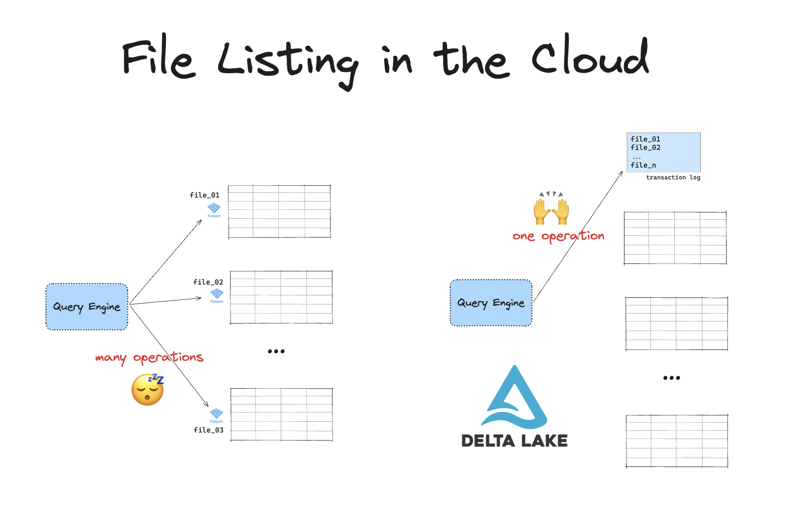

Data engineers can read and write Delta Lake tables on Amazon S3 with Spark and Polars. Delta Lake Spark 4.5 and above supports multi-cluster writes through S3 conditional writes on compatible Hadoop S3A runtimes. Existing DynamoDB deployments can follow the [migration guide](https://docs.delta.io/porting/#migrate-s3-writes-from-dynamodb-to-native-conditional-writes).

Delta Lake is a great storage format for reliable and fast data storage. It provides features like ACID transactions, scalable metadata handling, high-performance query optimizations, schema enforcement and time travel. With these features you can build a performant lakehouse architecture on top of your data lake.

S3 is a popular place to store data objects in the cloud. Storage on S3 is cheap and accessing it is efficient, especially for batch workloads. Many organizations use S3 to build a data lake, for example with Parquet files.

This article will show you how to read and write Delta tables from and to S3. We will cover code examples with Spark and Polars.

You will learn:

- Why Delta Lake is a great choice for S3 workloads
- How to configure your Spark session for proper S3 access with Delta Lake
- How to set up your Python environment for proper S3 access with Delta Lake

Let's jump in! 🪂

## Why Delta Lake is great for S3

Cloud object stores are slow at listing files. This can become a serious problem when you're working with large volumes of data. Delta Lake makes your queries on data in object stores much more efficient.

Cloud-based file systems use a flat namespace rather than a hierarchical file system. This means that there are no real directories. Directories are simulated by attaching prefixes to object keys. Listing operations require the engine to scan _all_ of the files and filter based on these prefixes.

Cloud-based file systems also impose API rate limits. This means you have to make many API calls to list your files. Together, these two factors can cause bottlenecks when you're listing many files.

Suppose you have a table stored in a data lake on S3. The data in this table is spread over many files in a directory. To run a query on this table, your engine will first need to list all the files and then filter for the relevant ones. On S3, a LIST operation is limited to 1000 objects. If your table has millions of files, this will result in high latency and slower queries.

Delta Lake stores all the file paths in a separate transaction log. This way you can avoid expensive file listing operations. Your engine only needs to perform a single operation to get the paths to all the relevant files for your query. This is much more efficient.



Delta Lake has many more benefits compared to data lakes on S3. You can read about them in the [Delta Lake vs Data Lake](https://delta.io/blog/delta-lake-vs-data-lake/) blog.

## How to use Delta Lake on S3

Many query engines support reading and writing Delta Lake on S3.

For example, you can read Delta Lake tables with Spark using:

```python
    df = spark.read.format("delta").load("s3a://example-bucket/delta-table")
```

And you can write data to Delta Lake table with Spark using:

```python
	df.write.format("delta").save("s3a://example-bucket/delta-table")
```

You can also use [Delta Lake without Spark](https://delta.io/blog/delta-lake-without-spark/).

Some query engines require a few extra configuration steps to get up and running with Delta Lake. The following two sections will walk you through working with Delta Lake on S3 with Spark (using [delta-spark](https://docs.delta.io/latest/index.html)) and Python engines (using [python-deltalake](https://delta-io.github.io/delta-rs/)).

Let's look at an example of using Delta Lake on S3 with the Spark engine.

## Delta Lake on S3 with Spark

Use Delta Lake Spark 4.5 and above with a compatible Spark distribution, Hadoop S3A 3.4.2 and above, and matching Hadoop dependencies. Keep S3A conditional creation enabled. See [S3 conditional writes](https://docs.delta.io/delta-storage/#native-s3-setup) for the complete requirements.

1. Install a compatible `pyspark` and `delta-spark` environment and configure your S3 credentials. AWS Identity and Access Management (IAM) roles are recommended. The Hadoop runtime and `hadoop-aws` connector versions must match. Adding a newer connector JAR alone does not upgrade Spark's Hadoop runtime.

1. Start a Spark session. The following example assumes a compatible Spark distribution using Hadoop 3.4.2 and the corresponding Delta Lake 4.5 package:

   ```python
   import pyspark
   from delta import configure_spark_with_delta_pip

   builder = (
       pyspark.sql.SparkSession.builder
       .appName("delta-s3")
       .config("spark.sql.extensions", "io.delta.sql.DeltaSparkSessionExtension")
       .config(
           "spark.sql.catalog.spark_catalog",
           "org.apache.spark.sql.delta.catalog.DeltaCatalog",
       )
       .config("spark.hadoop.fs.s3a.create.conditional.enabled", "true")
   )
   spark = configure_spark_with_delta_pip(
       builder,
       extra_packages=["org.apache.hadoop:hadoop-aws:3.4.2"],
   ).getOrCreate()
   ```

1. Write and read a table. For example:

   ```python
   s3_path = "s3a://example-bucket/delta-table"
   spark.range(5).write.format("delta").save(s3_path)
   spark.read.format("delta").load(s3_path).show()
   ```

1. Check the driver logs for `io.delta.storage.S3LogStore`. Resolve a single-driver fallback before writing from independent Spark drivers.

### Single-driver and multi-cluster support

Supported Spark setups automatically select `S3LogStore` when no explicit LogStore setting applies. S3 conditional writes ensure that only one writer can create a given commit file, using the put-if-absent condition `If-None-Match: *`. Delta Lake's transaction conflict checks determine whether competing transactions can retry.

Older Delta versions and filesystems without the required capabilities retain the single-driver store by default. Existing `S3DynamoDBLogStore` settings continue to select DynamoDB after an upgrade. Follow the [DynamoDB migration procedure](https://docs.delta.io/porting/#migrate-s3-writes-from-dynamodb-to-native-conditional-writes) before changing an existing workload's commit protocol.

## Delta Lake on S3 with delta-rs

[delta-rs 1.0 and above uses S3 conditional writes](https://github.com/delta-io/delta-rs/discussions/4482) and no longer supports its DynamoDB LogStore. Use S3 configuration without DynamoDB locking options, and choose a version whose commit protocol is compatible with every writer on the table. Coordinate the transition of existing DynamoDB workloads before changing any client.

You don’t need to install extra dependencies to write Delta tables to S3 with engines that use the `delta-rs` implementation of Delta Lake. You do need to configure your AWS access credentials correctly.

Many Python engines use [boto3](https://boto3.amazonaws.com/v1/documentation/api/latest/index.html) to connect to AWS. This library supports reading credentials automatically from your local `.aws/config` or `.aws/creds` file.

For example, if you’re running locally with the proper credentials in your local `.aws/config` or `.aws/creds` file then you can write a Parquet file to S3 like this with pandas:

```python
    import pandas as pd
    df = pd.DataFrame({'x': [1, 2, 3]})
    df.to_parquet("s3://example-bucket/parquet-test-pandas")
```

The `delta-rs` writer uses its own storage client rather than `boto3`. Follow the [storage configuration](https://delta-io.github.io/delta-rs/) for your installed `deltalake` version when configuring credentials.

You can pass your AWS credentials explicitly by using:

- the `storage_options `kwarg
- Environment variables
- EC2 metadata if using EC2 instances
- AWS Profiles

Let's work through an example with Polars. The same logic applies to other Python engines like Pandas, Daft, Dask, etc.

Follow the steps below to use Delta Lake on S3 with Polars:

1. Install Polars and deltalake. \
    \
   For example, using: \
    \
   `pip install polars deltalake`

2. Create a dataframe with some toy data.

   ```python
   import polars as pl

   df = pl.DataFrame({"x": [1, 2, 3]})
   ```

3. Set the AWS region. This example uses credentials from the environment or an instance role:

```python
storage_options = {"AWS_REGION": "us-east-1"}
```

4. Write data to Delta table using the `storage_options` kwarg.

   ```python
   df.write_delta(
       "s3://bucket/delta_table",
       storage_options=storage_options,
   )
   ```

Use S3 conditional writes for safe concurrent commits. Do not enable `AWS_S3_ALLOW_UNSAFE_RENAME` to bypass commit coordination.

## Delta Lake on S3: Safe Concurrent Writes

Every writer on a Delta table must use a compatible atomic commit protocol. A client that writes unconditionally can overwrite another client's commit.

For new Spark workloads, use the supported S3 conditional write setup above. For existing `S3DynamoDBLogStore` workloads, keep the DynamoDB table, region, and configuration consistent until all clients complete the coordinated migration. The [compatibility instructions](https://docs.delta.io/delta-storage/#multi-cluster-setup) remain available for those deployments.

## Delta Lake on S3: Required permissions

Grant the S3 permissions required by your reads, writes, multipart-upload cleanup, and table maintenance. Commit coordination through S3 conditional writes uses S3 permissions. Applications that retain DynamoDB coordination also need DynamoDB permissions.

In AWS S3, you will need the following permissions:

- s3:ListBucket
- s3:GetObject
- s3:PutObject
- s3:DeleteObject
- s3:AbortMultipartUpload

Only applications retaining DynamoDB coordination need DynamoDB permissions. The permissions for that compatibility setup include:

- dynamodb:GetItem
- dynamodb:Query
- dynamodb:PutItem
- dynamodb:UpdateItem

## Using Delta Lake on S3

You can read and write Delta Lake tables from and to AWS S3 cloud object storage.

Using Delta Lake with S3 is a great way to make your queries on cloud objects faster by avoiding expensive file listing operations.

You can use Delta Lake with S3 using many different query engines. Some of these engines require some additional configuration to get up and running.

Whichever query engine you choose to use, you will gain the benefits of Delta Lake's core performance and reliability features like query optimization, efficient metadata handling and transaction guarantees.
